# Queue Manager

An open-source, self-hosted service that decouples third-party systems (an
ERP, a POS, a logistics platform — anything external) from calling your
backend services directly, so a burst or a misbehaving integration never
turns into a spike against production.

## What is Queue Manager?

Instead of a third party calling your backend directly, it POSTs an
encrypted payload to a Queue-owned entry point. Queue Manager persists the
request, then a throttled worker forwards it to the real destination at a
controlled, configurable pace — decoupling "how fast the third party sends"
from "how fast your backend can safely take it."

It's built to be genuinely self-hosted with as few moving parts as
possible:

- **One external dependency: MongoDB.** No message broker to install,
  configure, or monitor — dispatch is handled entirely in-process, backed
  by Mongo (see "How it works" below).
- **Open source, single Go binary** plus a plain HTML/JS console — no
  frontend build step, no separate frontend service.
- **Encrypted ingest.** Payloads travel AES-256-CBC encrypted end to end;
  only Queue Manager, holding the integration's key/IV, can read them.
- **Throttled, per-destination pacing** that protects each downstream
  service independently, even when several destinations share one channel.
- **Multi-destination routing** — fan one entry point out to several
  destinations by a field in the payload, no hand-rolled rules engine.
- **Manual retry with a full audit trail.** Every request's outcome,
  decrypted body, and raw response is visible in the console; nothing
  retries automatically and silently.
- **Automatic cleanup** — requests expire and are purged per-channel on a
  retention period you configure.
- **An admin console with real access control** — bcrypt passwords, JWT
  sessions, optional TOTP two-factor, and a super-admin role gating who can
  manage other admins.

**Terminology note:** the UI and this doc use product-facing names that
differ from the underlying code/schema names (kept as-is internally to
avoid a breaking migration): **Console Admin** (code: `admin`), **Integration**
(code: `product`), **Transmission Channel** (code: `template`), **Transmission
Request** (code: `request`). Where this doc references an actual field, route,
or collection name, it uses the code name verbatim in backticks.

## How it works

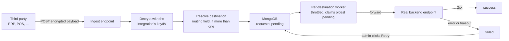

1. A third party POSTs an AES-256-CBC encrypted payload to
   `POST /ingest/<entry-point>`.
2. Queue looks up the owning transmission channel by entry point and
   decrypts the payload using that channel's integration key/IV.
3. A channel has one or more **destinations**. With one, every request goes
   to it — no further decision needed. With several, the channel also has a
   `template_routing_field`: Queue reads that field out of the decrypted
   JSON payload and matches its value against each destination's configured
   `destination_routing_value` to pick exactly one. No match → `400`
   immediately, nothing persisted or queued (see "Routing between multiple
   destinations" below).
4. The request is persisted to `requests` as `pending` with the resolved
   `destination_id`, and that destination's consumer goroutine is woken
   (a non-blocking in-process signal) so it picks it up right away instead
   of waiting for its next poll tick.
5. A per-destination goroutine consumer atomically claims the oldest
   `pending` request for that destination (`FindOneAndUpdate` to
   `processing` — the same primitive that would keep this correct even if
   more than one app instance ends up polling the same destination),
   forwards it to the destination's endpoint, and records the outcome
   (`success`/`failed`) — pacing claims by that destination's own
   `destination_throttling_second`, independent of any other destination
   on the same channel. If nothing's pending, the consumer blocks until
   woken or its next poll tick (~300ms), rather than busy-looping.
6. Failures sit until a console admin clicks **Retry** on the transmission
   request grid — there is no automatic retry, and retry flows through the
   exact same claim-and-forward code path as normal ingestion.
7. Transmission requests expire and are purged automatically via a MongoDB
   TTL index, based on each transmission channel's
   `template_request_ttl_days` (shared across all of a channel's
   destinations).

On startup, any request left stuck in `processing` by a previous crash
(claimed but never finished) is reset back to `pending` before consumers
start, so nothing is silently dropped by an unclean shutdown.

## Requirements

- Go 1.21+ (or just Docker — see "Running with Docker" below)
- MongoDB 3.6+ reachable at `MONGO_URI` (the Mongo driver is pinned to the
  v1.x line specifically for 3.6 compatibility — do not upgrade to
  `go.mongodb.org/mongo-driver/v2`, which requires Mongo ≥4.0)

That's it — no message broker or other service to stand up. Dispatch is
in-process, backed entirely by MongoDB.

## Running with Docker

This is the fastest path to a working instance — no Go toolchain needed on
the host at all, just Docker. `docker-compose.yml` runs exactly two
services, `mongo` and `app` (built from the `Dockerfile`); nothing else to
install.

### Prerequisites

- Docker with the Compose v2 plugin — `docker compose version` should print
  something, not error (the old standalone `docker-compose` v1 binary isn't
  what these instructions use)

### 1. Get the source

```sh
git clone <this-repo-url> queue-manager
cd queue-manager
```

### 2. (Recommended) set a stable JWT_SECRET

Skip this for a quick local try — the server will generate a random secret
and log a warning. Set a real one for anything you'll come back to, since
without a stable secret every admin session is invalidated whenever the
container restarts:

```sh
cp -n .env.example .env      # only copies if you don't already have one
```

Then open `.env` and set `JWT_SECRET=` to a real value, e.g. the output of
`openssl rand -hex 32`. Docker Compose loads this same `.env` file
automatically for its own variable substitution — it's the same file the
non-Docker path below uses, so if you've already run through "Running
locally" you likely have one set up already and can skip this step. (Note
the mechanism is different even though the file is shared: the container
never sees `.env` itself — Compose reads it and passes `JWT_SECRET` in as a
real environment variable, same as any other `environment:` entry.)

### 3. Build and start

```sh
docker compose up -d --build
```

First run builds the image (a minute or two); after that, `up -d` just
starts the existing one. Mongo's data lives in a named Docker volume
(`mongo_data`), so it survives `docker compose down` and container
restarts — only `docker compose down -v` (or deleting the volume directly)
throws it away.

### 4. Create the first console admin

There's no public sign-up — same as the non-Docker path, the first admin
is created via `seedadmin`, run once inside the running `app` container:

```sh
docker compose run --rm app /app/seedadmin -email=you@example.com -password=yourpass -name="You"
```

Always pass explicit flags here, the same as outside Docker — the bare-flag
defaults (`admin@example.com` / `12345678`) are public and guessable to
anyone who's read this file. The password must be at least 8 characters,
same rule the console's own admin-creation form enforces.

### 5. Open the console

`http://localhost:8080` (or whatever `APP_HOST_PORT` you set — see below).

### Configuration

Set these in the `.env` file from step 2, or export them in your shell
before `docker compose up` — either way Compose picks them up:

| Variable        | Default  | Purpose                                                          |
|-----------------|----------|-------------------------------------------------------------------|
| `JWT_SECRET`    | *(none)* | Signs admin session/2FA tokens — set a stable value (step 2)     |
| `APP_HOST_PORT` | `8080`   | Host port the console/ingest endpoint is published on            |

`APP_HOST_PORT` matters if 8080 is already taken on your host, or if
you're running more than one instance side by side (this is also what
`scripts/e2e-docker-test.sh` uses to test without colliding with a real
deployment — see "Tests" below).

### Day-to-day operations

```sh
docker compose logs -f app      # tail the app's logs
docker compose restart app      # restart just the app (Mongo keeps running)
docker compose down             # stop everything, keep the mongo_data volume
docker compose down -v          # stop everything AND delete all Mongo data
```

To pick up a code change (yours, or a `git pull` of a new release), rebuild
and recreate just the app container — Mongo and its data are untouched:

```sh
git pull
docker compose up -d --build app
```

### Verifying it actually works

`scripts/e2e-docker-test.sh` drives this exact `docker compose` setup
through a real ingest → decrypt → route → throttle → forward → retry cycle
end to end (see "Tests" below) — worth running once after your first setup,
or after pulling an update, to confirm the whole stack is healthy.

### Running without Compose

If you'd rather point the container at a Mongo you already run elsewhere,
skip Compose and run the image directly:

```sh
docker build -t queue-manager .
docker run -d --name queue-manager -p 8080:8080 \
  -e MONGO_URI="mongodb://your-mongo-host:27017" \
  -e MONGO_DB_NAME="queue_manager" \
  -e JWT_SECRET="$(openssl rand -hex 32)" \
  queue-manager
docker exec queue-manager /app/seedadmin -email=you@example.com -password=yourpass -name="You"
```

## Running locally

```sh
cp .env.example .env      # adjust if needed; JWT_SECRET can be left blank for local dev
go run ./cmd/server
```

The server must be run with the project root as its working directory,
since it serves the console frontend from `WEB_DIR` (default `web/`) — that
matters if you deploy it as a systemd service (`WorkingDirectory=`) rather
than running via `go run`/`go build` from this directory.

There is no public sign-up for the console — create the first console
admin with the seed command before logging in:

```sh
go run ./cmd/seedadmin                                       # admin@example.com / 12345678
go run ./cmd/seedadmin -email=you@example.com -password=... -name="You"
```

It's idempotent (skips if the email already exists). Every console admin
after the first is added by an already-logged-in console admin from the
**Console Admins** page in the console (`/api/admins`) — there's no other
way to create one, so an unauthenticated visitor can never register
themselves.

### Seeding a console admin (dev, staging, production)

`cmd/seedadmin` is a one-off CLI, not an HTTP endpoint — it talks to Mongo
directly, using the exact same config loading as the server (`godotenv.Load()`
reads a `.env` in the current working directory if present, then falls back
to real environment variables). That means "which Mongo it seeds into"
depends entirely on which `MONGO_URI`/`MONGO_DB_NAME` are in scope when you
run it — there's no `-env` flag or separate prod/dev switch.

**Local dev** — run it straight from the project root, where `go run` and
your local `.env` both already work:

```sh
go run ./cmd/seedadmin -email=you@example.com -password=yourpass -name="You"
```

**Staging / production** — the target host generally won't have the Go
toolchain wired up for `go run`, and you don't want to rebuild from source
on every seed. Build the binary once (e.g. as part of your normal deploy
build alongside `cmd/server`) and ship it next to the server binary:

```sh
go build -o seedadmin ./cmd/seedadmin
```

Then, on that host, from whichever directory has the production `.env` (or
with `MONGO_URI`/`MONGO_DB_NAME` exported as real env vars — e.g. set in the
systemd unit), run:

```sh
./seedadmin -email=admin@yourcompany.com -password='<strong-password>' -name="Your Name"
```

Things that matter specifically outside local dev:

- **Always pass explicit flags.** Never run it bare (no flags) anywhere
  reachable from outside your laptop — the flag defaults are the public
  `admin@example.com` / `12345678` shown above, which is a guessable
  credential to anyone who's read this file or the source.
- **Safe to bake into deploy scripts.** Because it's idempotent, re-running
  it on every deploy is fine — it just skips with a "already exists"
  message if that email is already a console admin.
- **Double-check which Mongo you're pointed at.** It resolves config the
  same lazy way the server does, so running it from the wrong working
  directory (wrong/no `.env`) or without the right env vars exported will
  silently seed the wrong database (commonly: your local Mongo instead of
  production) rather than erroring.
- **It only creates the *first* console admin per email.** There's no route
  to seed a second "break-glass" console admin later except running this
  same command again with a different `-email` — after that, additional
  console admins are created from inside the app by an existing console
  admin, not via this CLI.

## How to use the console

Once you're logged in, here's a walkthrough of the four things you'll do
most — using the same sample data as the in-app **Setup Guide**
(open `/guide.html` from the sidebar once your instance is running), so
every screenshot below matches what you'd actually see.

### 1. Create an Integration

An Integration represents one third-party system that will send data into
the queue — an ERP, a POS, a logistics platform, anything that needs to
call into your backend without calling it directly. Each one gets its own
AES-256 key and IV, so a problem with one third party's credentials never
affects another's. Create the integration first; a Transmission Channel
always belongs to one.

Open **Integrations** and click **+ New integration**. The list shows every
third-party system you've onboarded, its description, and its
authentication key/IV (masked on screen, with a one-click Copy button — the
API still returns the real values to any signed-in console admin, this is
just a display choice).

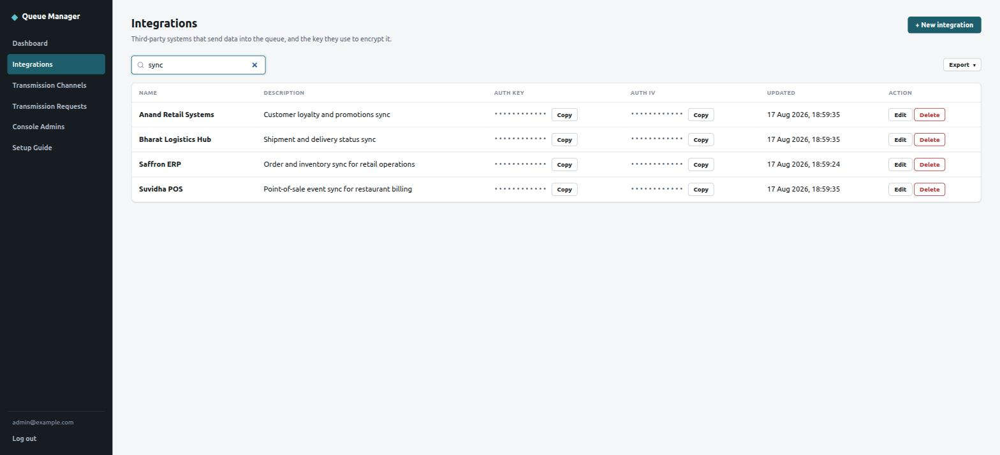

Give the integration a name and description, then set:

- **Authentication key** — exactly 32 characters, used as the AES-256 key
- **Authentication IV** — exactly 16 characters, the initialization vector

Both travel to the third party out of band (Slack, a shared doc, however
you hand off credentials today) — Queue Manager never transmits them
anywhere itself, it only stores them to decrypt what comes back in.

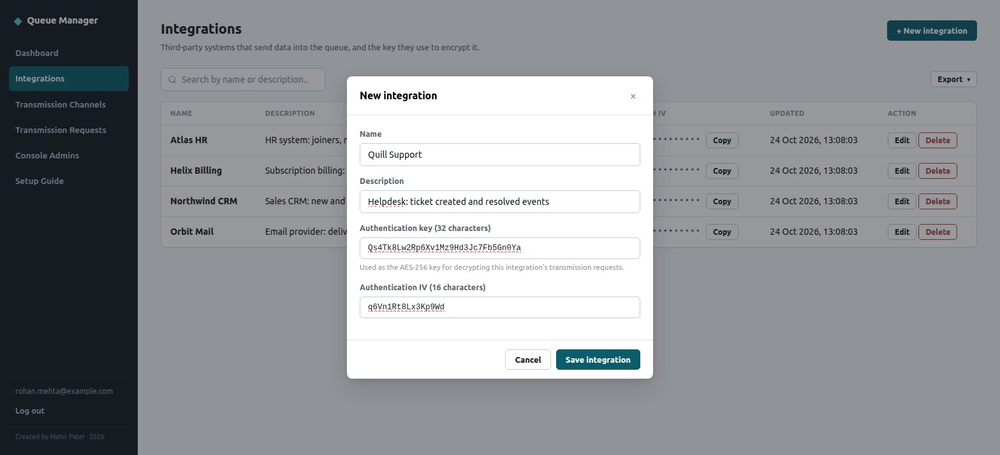

Save, and the integration is ready to be attached to one or more
Transmission Channels. Nothing is listening for traffic yet — an
integration on its own doesn't expose any URL.

### 2. Set up a Transmission Channel

A Transmission Channel is one entry point URL that the third party posts
encrypted payloads to. Behind it, Queue Manager fans requests out to one or
more destinations at a controlled, throttled pace — so a burst from the
third party never turns into a burst against your real backend.

Open **Transmission Channels** and click **+ New transmission channel**.
Each row shows which integration the channel belongs to, its entry point,
how many destinations it fans out to, its retention (TTL), and whether
it's active.


The dialog is a 3-step wizard:

**Step 1 — Channel Detail.** Pick which Integration this channel belongs
to, then give the channel its own name and description. One integration
can own several channels — sharing the same key/IV but each with its own
entry point, retention, and destinations.

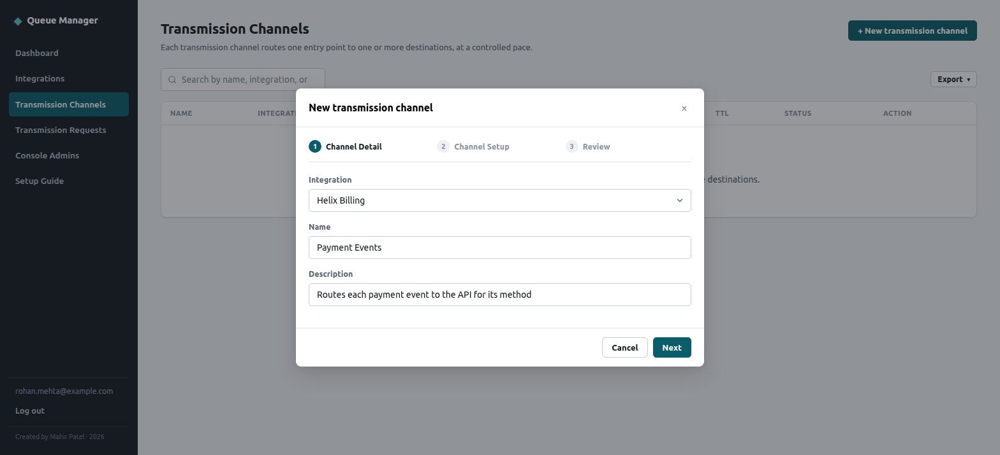

**Step 2 — Channel Setup.** Set the entry point slug (the path third
parties POST to) and how long to keep request records before automatic
cleanup. Then add one or more **destinations**, each with its own endpoint
URL and a throttle (gap between sends, in seconds) — this is what protects
the real backend. With a single destination, every request goes straight
there, no routing needed.

Add a second destination and a **Routing field** appears. Below,
`payment_type` routes to **UPI Payments API** (value `upi`) or **Card
Payments API** (value `card`) — Queue Manager reads that field out of the
decrypted payload and hands the request to whichever destination's value
matches.

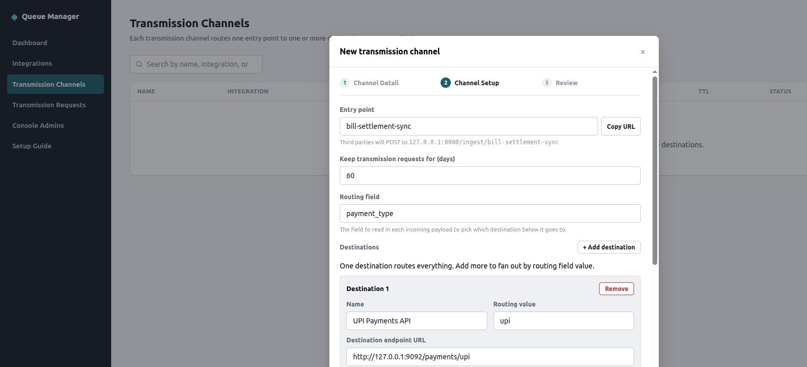

**Step 3 — Review.** Shows every destination with its resolved routing
rule in plain language, so you can sanity-check the whole fan-out before
committing. From here, **Download sample integration doc** generates a
Markdown handoff file with the real ingest URL, headers, the encryption
recipe, the integration's key/IV, and — per destination — a sample payload
already encrypted with the real key/IV plus a ready-to-run `curl` command,
so whoever implements the sending side has nothing left to guess.

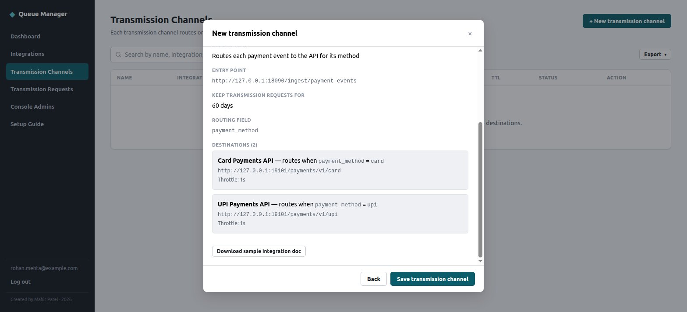

Saving creates the channel **inactive** — nothing is listening yet. Click
**Activate** on its row to start a worker for each destination; the entry
point only starts accepting traffic once you do. **Deactivate** reverses it
without deleting anything — requests already waiting for a destination
stay queued untouched, so pausing a channel to fix a downstream issue never
drops a backlog.

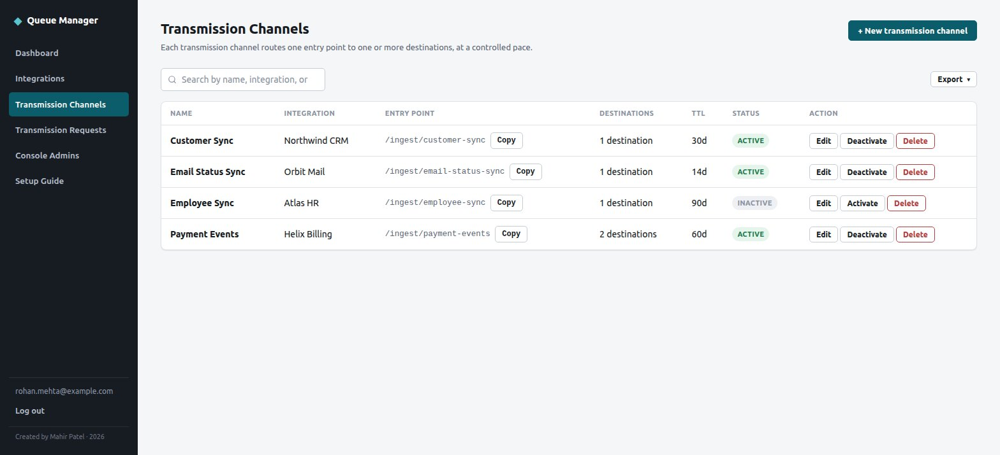

### 3. Monitor & retry Transmission Requests

Every payload that hits a channel's entry point becomes one Transmission
Request — this is the single place to see everything that has flowed
through the queue, in every state, across every channel and destination,
and to step in by hand when something on the receiving end goes wrong.

Open **Transmission Requests**. Narrow the grid by channel, status
(`pending`/`processing`/`success`/`failed`), or date range, or search the
currently loaded rows by request ID or channel name. The colored rail on
the left edge of each row is the fastest way to scan a long list for
trouble — green for success, red for failed.

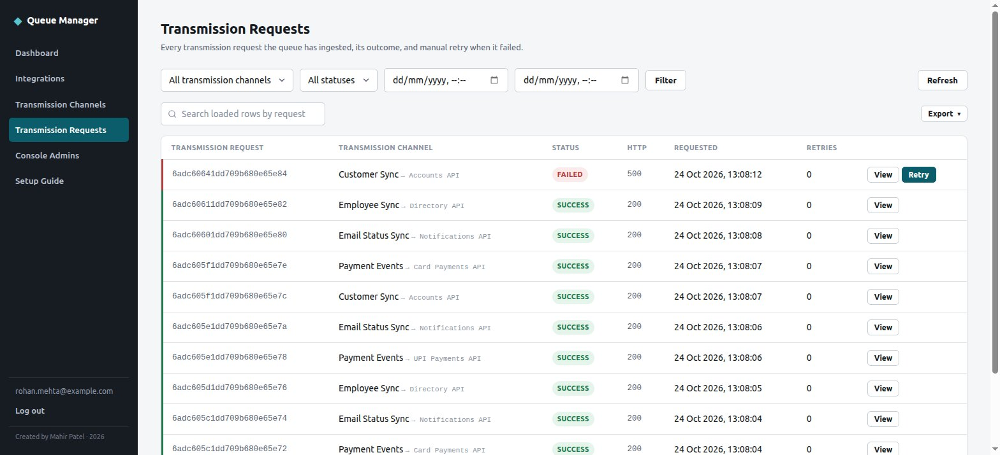

Click **View** on any row for its full detail: which channel and
destination it was headed to, the exact endpoint URL called, the request's
decrypted body exactly as received, and the raw response (HTTP status +
body) that came back. Below, an order failed with HTTP 500 because the
destination endpoint was temporarily broken — the response body makes the
reason obvious without needing to check server logs.

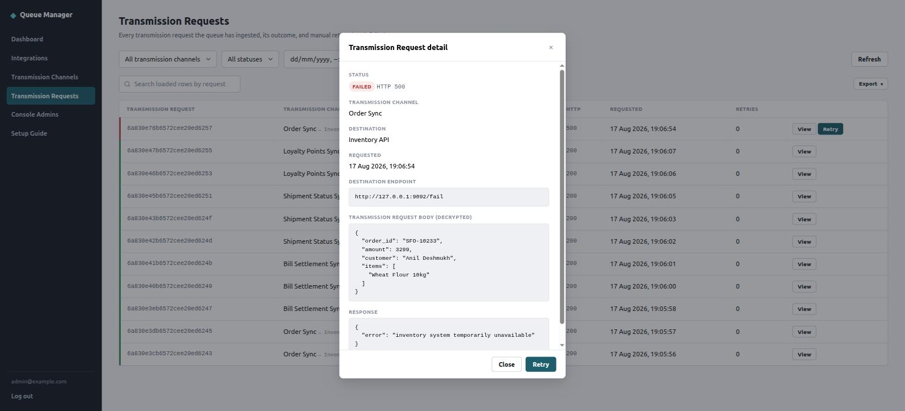

Fix the underlying problem first (in this example, correct the
destination's endpoint URL on the channel), then click **Retry** from the
detail dialog or straight from the grid row. Retry always re-publishes
against the destination's *current* configuration, not whatever was in
effect when it first failed — so "fix the endpoint, then retry" genuinely
works. The retry count ticks up and the original decrypted payload is
reused as-is.

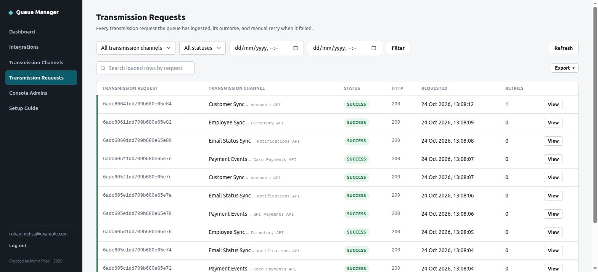

Retry is always a manual, deliberate action — Queue Manager never
auto-retries a failed request on its own. A downstream outage shouldn't
turn into a retry storm hammering the same broken endpoint.

### 4. Manage your team (Console Admins)

Console Admins are the people who can sign in and manage this console.
They're added here by an existing admin, not through public sign-up —
there's deliberately no registration page.

Open **Console Admins**. The very first admin ever seeded on a fresh
install becomes the **Super Admin** automatically. Only a Super Admin can
create new console admins or turn off someone else's two-factor
authentication; every other admin can see this list — including everyone's
role and 2FA status — but can't edit it, add to it, or act on anyone but
themselves.

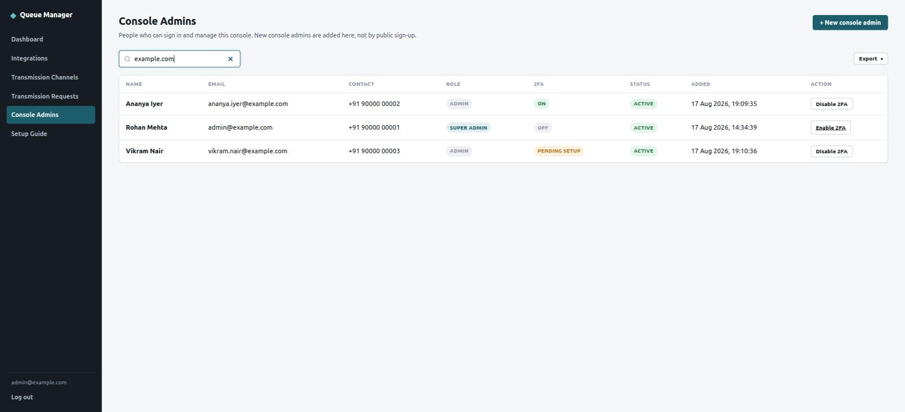

As a Super Admin, click **+ New console admin** and fill in their name, an
optional contact number, email, and a starting password (at least 8
characters). Check **"Require two-factor authentication setup before first
login"** to force them through QR-code enrollment the very first time they
sign in — they can't reach any other page in the console until they've
confirmed a valid code. Leave it unchecked and they can sign in with just
their password and opt into 2FA on their own terms later.

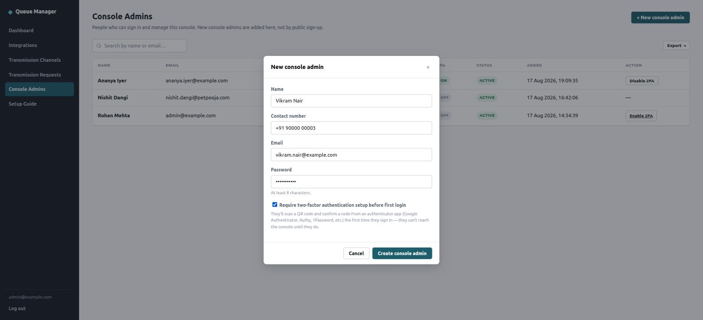

Turning 2FA **on** is unrestricted self-service for every admin, regardless
of role. Turning it **off** is deliberately one-directional: only a Super
Admin can disable another admin's 2FA (not even their own, without going
through the same super-admin path) — that asymmetry is intentional, since
disabling an already-active protection is a recovery action that needs a
second party involved, exactly the situation when someone loses their
phone.

---

This walkthrough, kept current with the app, is also available inside the
console itself under **Setup Guide** once you're logged in.

## Project layout

Directory/file/field names below are the internal code and schema names —
they don't always match the product-facing UI names (`admin` = Console
Admin, `product` = Integration, `template` = Transmission Channel,
`request` = Transmission Request; see the terminology note above).

```
cmd/server/main.go        wiring, graceful shutdown, worker bootstrap
cmd/seedadmin/main.go     one-off CLI to create the first console admin (no public sign-up exists)
internal/
  config/                 env/.env -> Config
  db/                     Mongo connect + index setup (see EnsureIndexes for the full index list)
  models/                 queue_admins / products / request_templates / requests
  crypto/                 AES-256-CBC decrypt matching third parties' openssl_encrypt(OPENSSL_RAW_DATA)
  authtoken/               JWT issue/verify shared by handlers + middleware
  worker/                 per-destination consumer goroutines (claim from Mongo, throttled forwarding), bootstrap + crash recovery
  handlers/               HTTP handlers (auth, admins, products, templates, requests, ingest)
  middleware/             session auth, request logging
  httpclient/             shared HTTP client used to call a destination's endpoint
web/                      console frontend — plain HTML/CSS/JS, no build step, served directly
Dockerfile, docker-compose.yml   containerized app + Mongo, no other services
```

## Encryption

Third parties (including PHP-based senders) encrypt the JSON payload like:

```php
$encrypted = openssl_encrypt(json_encode($data), 'AES-256-CBC', $key, OPENSSL_RAW_DATA, $iv);
$encoded   = urlencode(base64_encode($encrypted));
```

`product_authentication_key` (32 bytes) / `product_authentication_iv` (16
bytes) are stored per integration and used as-is (no hashing/derivation).
`internal/crypto` reverses this exactly; its test suite validates against a
ciphertext generated by real PHP `openssl_encrypt`, not just Go-to-Go
round-trips.

## Console admin auth

Bcrypt-hashed passwords, JWT session in an httpOnly cookie, optional TOTP
2FA (Google Authenticator-compatible). 2FA enrollment is stateless — the
generated secret travels in a short-lived signed token between
`/api/auth/2fa/setup` and `/api/auth/2fa/setup/confirm` rather than being
written to the database until the console admin proves they've set it up
with one valid code.

## Retry semantics

Retry is manual only, from the transmission request grid. Clicking it:
- looks up the request's original destination (by `destination_id`) on the
  *current* version of the template — if that destination was since
  deleted, retry is refused with a clear conflict rather than guessing
- refreshes the request's `destination_end_point` snapshot to that
  destination's *current* endpoint (a retry is often triggered specifically
  because the endpoint config was just fixed)
- increments `retry_count`, sets `recent_request_retry_at`/`_by`
- resets `request_process_status` to `pending` and wakes that destination's
  consumer, the same way ingestion does

Only transmission requests currently in `failed` status can be retried.

## Routing between multiple destinations

A channel with one destination behaves exactly as if routing didn't
exist — no routing field, no per-destination matching, every request goes
to that one destination. Add a second destination and two things become
required: `template_routing_field` on the channel, and a unique
`destination_routing_value` on every destination.

On ingest, Queue parses the decrypted payload as a JSON object, reads
`template_routing_field` out of it, and matches the (string-formatted)
value against each destination's `destination_routing_value`. First and
only match wins — values are required to be unique within a channel, so
there's never ambiguity. No match, a missing field, or a non-object
payload all fail the request immediately with `400` and a message naming
what went wrong; nothing is persisted or queued in that case, so it never
shows up as a `failed` row to retry — it never entered the system.

This is deliberately simple: one shared field per channel, not a
per-destination field. Only the app can inspect the payload (it's encrypted
in transit), so *something* has to extract the routing value at ingest
time regardless — keeping that extraction to one field per channel means
it's a single lookup that resolves straight to a `destination_id`, stored
on the request before anything else happens, rather than a hand-rolled
per-destination rule engine.

## Transmission channel activate/deactivate

Both are confirmed in the UI before taking effect (each has real
consequences), and both operate on *every* destination on the channel at
once:
- **Activate** starts one consumer goroutine per destination, each of
  which immediately starts claiming any backlog already sitting `pending`
  against it.
- **Deactivate** cancels every destination's consumer. Nothing is deleted —
  backlog is just `pending` rows in `requests`, so it sits there untouched
  and picks up exactly where it left off the next time the channel is
  activated. Pausing a channel to fix a downstream issue never drops
  anything.

Editing an *active* channel's destinations restarts its consumers with the
fresh config (stop, then start against the new destination set) — this is
never destructive to backlog, since a destination that keeps its id (edit
its name/endpoint/throttle, but it's still "the same destination") keeps
every `pending`/`failed` row already tagged with that id regardless of
what else about the channel changed, including the entry point.

Permanently deleting a transmission channel stops its consumers, in
addition to removing the transmission channel record.

## Transmission channel form

- `template_name` and `template_entry_point` are both globally unique
  (enforced by Mongo unique indexes; the API returns a 409 naming which
  field collided). The entry point field auto-suggests a unique slug from
  the name as you type (stops once you edit the entry point directly —
  same UX as a CMS permalink field), and both fields get an inline
  "already in use" hint client-side before you even submit.
- Destinations are a repeatable list in the same dialog — one by default,
  with a "+ Add destination" control. The routing-value field and each
  row's "Remove" button only appear once there are two or more rows (see
  "Routing between multiple destinations" above).
- Each destination has a stable, server-assigned id (never hand-typed, so
  it can't collide by typo) that its backlog is tracked against — renaming
  a destination or reordering the list never loses track of it, and
  neither does renaming the channel's entry point.
- A "Copy URL" button (in both the transmission channel dialog and the
  transmission channels table) copies the full ingestion URL — origin +
  `/ingest/<slug>` — for handing to the third party.

## Tests

```sh
go test ./...
```

That's just `internal/crypto`'s unit tests. For an actual end-to-end check
of the worker/dispatch subsystem — ingest, decrypt, route, throttle,
forward, manual retry, deactivate/reactivate backlog preservation, and
crash recovery, all against the real Dockerized stack:

```sh
./scripts/e2e-docker-test.sh
```

It builds and runs its own isolated `docker compose` project (safe to run
alongside a real deployment on the same host), spins up two throwaway HTTP
destinations to forward to, asserts on the outcome of each step, and tears
everything down when it's done — pass or fail. Requires Docker and Go on
the host (Go is only needed to build a tiny test-payload encryption
helper; the app itself never needs it to run in Docker).
